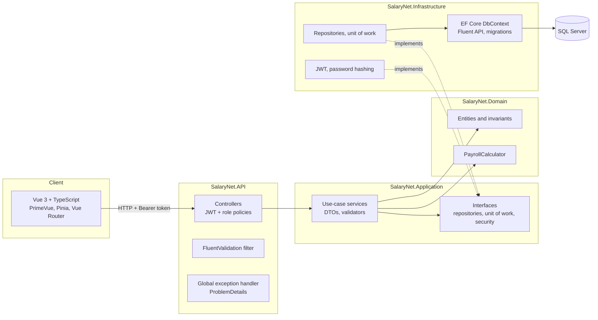

# SalaryNet

A full-stack payroll and HR management system built with **ASP.NET Core 8 Web API**, **Clean Architecture**, **EF Core on SQL Server** and a **Vue 3 + TypeScript** front end.

It covers the core flows of a payroll product: employees and departments, monthly payroll with a tiered tax calculation, attendance tracking, and role-based access where employees can only ever see their own records.

> All data in this project is fictional demo data.

**Live demo:** the front end runs on GitHub Pages in demo mode (the same business rules executed in the browser). Sign in with one click as Admin, HR or Employee.

---

## Highlights

- **Clean Architecture**: Domain, Application, Infrastructure and API layers with dependencies pointing inward. The domain has no framework dependencies.
- **Rich domain model**: entities protect their own invariants (private setters, factory methods, guard clauses). `TotalHours` is derived at check-out and cannot be set from outside.
- **Payroll engine**: a documented progressive tax and social-security calculator, unit-tested against hand-calculated values.
- **Database-enforced rules**: a unique composite index on `(EmployeeId, Year, Month)` prevents duplicate payslips even under concurrent requests (covered by an integration test that fires 5 parallel requests). A filtered unique index allows only one open shift per employee.
- **Account security**: per-account lockout after repeated failed sign-ins, a password policy, admin unlock and reset, and deactivation without deleting history.
- **Security**: JWT authentication, `Admin` / `HR` / `Employee` role policies, and resource-level authorization that blocks IDOR. An employee who asks for someone else's payslip gets `404`, and a spoofed `employeeId` filter is ignored.
- **Consistent errors**: every failure is returned as RFC 7807 `ProblemDetails` with a `traceId`. Validation errors come back per field from FluentValidation.
- **Tests**: 132 xUnit test methods (162 test cases) (unit tests with Moq and FluentAssertions, plus integration tests with `WebApplicationFactory` against a real SQL Server in Testcontainers) and Vitest tests on the front end.

## Architecture



| Project | Responsibility |
| --- | --- |
| `SalaryNet.Domain` | Entities, enums, domain exceptions, `PayrollCalculator`. No external dependencies. |
| `SalaryNet.Application` | Use-case services, DTOs, FluentValidation validators, paging and filtering, and the interfaces the outer layers implement. |
| `SalaryNet.Infrastructure` | `SalaryNetDbContext`, Fluent API configurations, migrations, repositories, unit of work, JWT generation, password hashing, demo data seeder. |
| `SalaryNet.API` | Controllers, authorization policies, global exception handler, validation action filter, Swagger, DI composition root. |
| `SalaryNet.Tests` | xUnit unit tests and integration tests. |
| `web/` | Vue 3 front end with an HTTP client for the real API and an in-browser demo implementation. |

## Business rules

| Rule | Where it is enforced |
| --- | --- |
| Email is unique per employee (case-insensitive) | Normalized in the domain, unique index in SQL Server, `409 Conflict` from the API |
| One payslip per employee per month | Unique index `UX_PayrollRecords_Employee_Period`, checked in the service and caught again on save |
| No payroll for future periods or inactive employees | `PayrollRecord.Generate` (`422 Unprocessable Entity`) |
| Gross - deductions = net | Calculated in the domain and guarded by a SQL check constraint |
| `TotalHours` is computed only at check-out | `AttendanceLog.CheckOutAt` |
| One open shift per employee | Filtered unique index plus a service check |
| Employees see only their own payroll and attendance | Services read the employee id from the token's claims, never from the request |
| Departments can be changed only by Admin, and deleted only when empty | Role policy plus a service check |
| 5 failed sign-ins in a row lock the account for 15 minutes; failures during a lockout do not extend it | `User.RegisterFailedLogin`, admin can unlock or reset the password |
| Unknown, inactive and locked accounts get the same generic `401` | `AuthService.LoginAsync` (no account enumeration) |
| Passwords need 8+ characters with upper case, lower case and a digit | FluentValidation `PasswordPolicy` |
| Admins cannot deactivate themselves or change their own role | `UserService` (`422`) |

### Payroll calculation

Gross salary is base salary plus bonus. Income tax is progressive: each rate applies only to the part of the salary inside its bracket.

| Monthly gross (ILS) | Rate |
| --- | --- |
| 0 - 7,010 | 10% |
| 7,010 - 10,060 | 14% |
| 10,060 - 16,150 | 20% |
| 16,150 - 22,440 | 31% |
| 22,440 - 46,690 | 35% |
| above 46,690 | 47% |

Social security is 3.5% up to 7,500 and 12% from 7,500 up to a 50,000 ceiling. Nothing is withheld for contractors. The rates are loosely modeled on the Israeli system for illustration only and are not official figures.

## API

| Method | Endpoint | Access |
| --- | --- | --- |
| `POST` | `/api/auth/login` | Anonymous |
| `GET` | `/api/auth/me` | Any signed-in user |
| `POST` | `/api/auth/change-password` | Any signed-in user |
| `GET` / `POST` | `/api/users` | Admin |
| `PUT` | `/api/users/{id}/role` | Admin |
| `POST` | `/api/users/{id}/deactivate`, `/activate`, `/unlock`, `/reset-password` | Admin |
| `GET` | `/api/employees?search=&departmentId=&employmentType=&isActive=&sortBy=&sortDirection=&page=&pageSize=` | Admin, HR |
| `GET` | `/api/employees/me` | Employee |
| `GET` | `/api/employees/{id}` | Admin, HR, or the employee themself |
| `POST` / `PUT` | `/api/employees`, `/api/employees/{id}` | Admin, HR |
| `POST` | `/api/employees/{id}/deactivate`, `/activate` | Admin, HR |
| `GET` | `/api/departments` | Admin, HR |
| `POST` / `PUT` / `DELETE` | `/api/departments[/{id}]` | Admin |
| `GET` | `/api/payroll?employeeId=&departmentId=&year=&month=` | Everyone (employees are scoped to themselves) |
| `GET` | `/api/payroll/{id}` | Owner or staff |
| `POST` | `/api/payroll`, `/api/payroll/run` | Admin, HR |
| `GET` | `/api/attendance` | Everyone (employees are scoped to themselves) |
| `GET` / `POST` | `/api/attendance/current`, `/check-in`, `/check-out` | Employee |
| `GET` | `/api/dashboard/summary` | Admin, HR |

Full interactive documentation is available in Swagger at `/swagger`.

## Running locally

### Everything in Docker

```bash
docker compose --profile full up --build
```

| URL | What |
| --- | --- |
| http://localhost:8080 | Web app |
| http://localhost:5080/swagger | API documentation |

The database is migrated and filled with demo data on first start.

### Development mode

Requirements: .NET 8 SDK, Node.js 22, Docker.

```bash
docker compose up -d sqlserver
dotnet run --project src/SalaryNet.API --launch-profile http
```

```bash
cd web && npm install && npm run dev
```

The UI runs at http://localhost:5173 and proxies `/api` to the API on port 5080.

To run the front end alone, without the API or database:

```bash
cd web && npm run dev:demo
```

### Demo accounts

| Role | Email | Password |
| --- | --- | --- |
| Admin | `admin@salarynet.demo` | `Demo123!` |
| HR | `hr@salarynet.demo` | `Demo123!` |
| Employee | `noa.cohen@salarynet.demo` | `Demo123!` |

## Tests

```bash
dotnet test
```

Integration tests need Docker running: Testcontainers starts a SQL Server container, and each test class gets its own freshly migrated database.

```bash
cd web && npm test
```

The front end's tax calculator is tested against the same values as the C# calculator, so the demo mode cannot drift from the backend.

## Tech stack

**Backend:** C# 12, .NET 8, ASP.NET Core Web API, EF Core 8, SQL Server 2022, FluentValidation, JWT Bearer, Swashbuckle

**Frontend:** Vue 3 (Composition API), TypeScript, Vite, Pinia, Vue Router, PrimeVue, Chart.js

**Quality:** xUnit, Moq, FluentAssertions, Testcontainers, WebApplicationFactory, Vitest, .NET analyzers with warnings as errors, central package management

**Delivery:** Docker, Docker Compose, nginx, GitHub Actions (CI and GitHub Pages)
